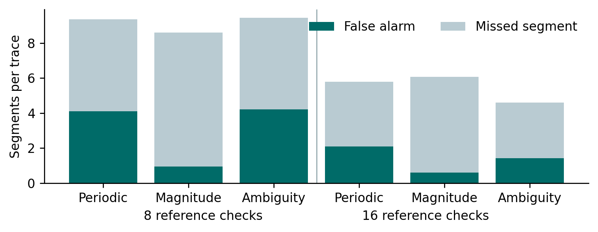

# When should a bead-width monitor spend its next reference measurement?

A printer camera reports a wider bead. A feed change and a shifted camera calibration can produce exactly the same readings. A second instrument can settle the question for one segment, but a build may allow only eight checks. This experiment asks when to spend them.

The timing of a check changes which defects the monitor sees. At eight checks per build, triggering on a large width deviation saved about 3.15 false alarms relative to periodic inspection and missed 2.41 more out-of-tolerance segments. Doubling the budget changed the ranking of the schedules.

[Read the manuscript (PDF)](manuscript.pdf) · [Browse the manuscript (Markdown)](manuscript.md) · [Inspect the paired runs (CSV)](results.csv)

## What was compared

The simulation generates 160 bead segments per build with a target-width tolerance of ±0.05 mm. It crosses three disturbance profiles (step, ramp and reversal) with four possible sources (stable, actual process change, sensor bias and cancellation). The camera sees identical traces in the process-only and sensor-only conditions when their underlying draws match. An independent noisy reference reveals the true width at the selected segments.

Three monitors use the same width estimator. One inspects at a fixed time in each block. Another triggers when the estimated deviation reaches tolerance. The third checks when a drift allowance overlaps the tolerance boundary. Every monitor gets exactly one check per block, including a fallback on the last segment. Each combination uses 320 paired random runs with seed 90217.

## Results at nominal camera noise

Entries are mean segment counts per 160-segment build, averaged equally across all twelve disturbance scenarios. Camera noise has a standard deviation of 0.012 mm.

| Checks per build | Timing rule | False alarms | Missed violations | Total errors |
|---:|---|---:|---:|---:|
| 8 | Periodic | 4.11 | 5.24 | 9.35 |
| 8 | Magnitude | 0.96 | 7.64 | 8.60 |
| 8 | Ambiguity | 4.22 | 5.23 | 9.45 |
| 16 | Periodic | 2.10 | 3.68 | 5.78 |
| 16 | Magnitude | 0.61 | 5.47 | 6.07 |
| 16 | Ambiguity | 1.42 | 3.17 | 4.59 |



An alarm never changes the simulated extrusion rate. That choice lets all three policies see the same physical build. A production comparison would also need to measure reference-instrument delays, the cost of stopping a print and the response of the extruder to a correction.

## Reproduce the comparison

Run from the repository root with Python 3.11. The study used Python 3.11.9 and NumPy 1.26.0. The simulation generates its inputs locally.

```bash
python -m pip install -r requirements.txt
python run.py
python verify.py
```

`run.py` regenerates the 34,560 records in `results.csv` and prints policy means and paired uncertainty estimates. `verify.py` uses the Python standard library to recalculate the six table rows directly from that file. The figure can also be redrawn from the saved results.

```bash
python -m pip install -r requirements-plot.txt
python make_figure.py
```

Repository maintained by **Vedant Thaker**.
