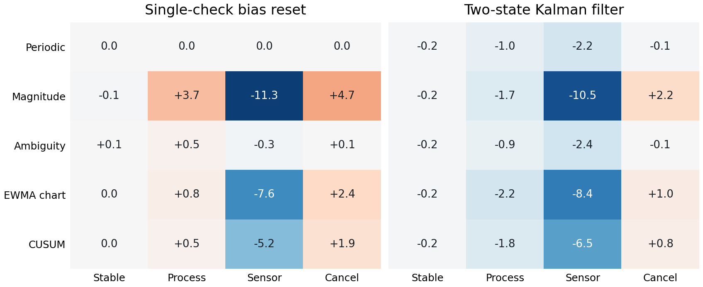

# Scheduling independent width checks when extrusion drift and camera bias produce identical readings

**Vedant Thaker**  
Independent Researcher, Jeffersonville, Indiana, United States  
Correspondence: vthaker1@asu.edu  
21 November 2026

## Abstract

A camera that measures bead width plus sensor bias can give exactly the same reading for excess extrusion and for a calibration shift. We used this ambiguity to test five schedules for an independent width check. All schedules used eight inspections on each shared 160-segment build under 12 fault conditions. With a single-check bias reset, periodic inspection averaged 4.11 false alarms and 5.24 missed violations per build. Triggering at the width tolerance saved 3.15 false alarms but added 2.41 misses. A separate EWMA chart averaged 1.99 false alarms and 6.28 misses. A two-sided CUSUM averaged 2.61 and 6.04. Changing the estimator while keeping the inspection times fixed also changed the result. A two-state Kalman filter with magnitude-triggered checks averaged 1.28 false alarms and 5.52 misses. This combination had the smallest total at the nominal settings. Changing the tolerance, instrument noise or filter assumptions changed the ranking. The comparisons quantify error costs on a specified generator. They do not estimate how often extrusion drift or compensating camera drift occurs on a printer.

## 1. Physical width and the camera reading

An inspection decision requires a definition of ground truth. Badarinath and Prabhu compared an in-process vision estimate with caliper measurements from printed material [1]. Guidetti et al. measured extrusion force during printing and compared it with deposited width at matched locations [2]. Their experiments show two ways to obtain information beyond a single image. In another manufacturing setting, Han et al. used predictive uncertainty to schedule metrology on semiconductor wafers [3].

Here the reference reads physical width directly. A fixed inspection budget lets us compare the effect of timing on identical synthetic traces. Withholding each reference until requested makes the distinction between a better schedule and a better use of the same reference measurements observable. Alarms label segments without altering extrusion.

## 2. An indistinguishable pair of camera traces

Let x be the true width deviation and b the camera bias at one segment. The camera returns y = x + b + e. Fix an underlying deviation u, a signed disturbance d and a camera-noise realization e. A process-shift state (x, b) = (u + d, 0) and a sensor-shift state (u, d) both return y = u + d + e. A cancellation state (u + d, −d) and the stable state (u, 0) both return y = u + e. Choosing d large enough can put one true width outside tolerance and leave the other inside.

This equality holds segment by segment for any disturbance trajectory. A causal policy with the same internal randomness therefore has identical information and takes the same action in either member of a pair until it observes an informative reference. More generally, a reference z = x + v has conditional means separated by d at affected segments. A single noisy reading can still be ambiguous. The identity rules out unique attribution from the camera alone, even for a filter that assigns different prior probabilities to the two explanations.

## 3. Width, disturbance and instrument model

Each build has 160 segments. Background deviation starts with a zero-mean Gaussian innovation and follows an autoregression with coefficient 0.7 and innovation standard deviation (SD) 0.005 mm. Independent Gaussian errors have nominal SDs of 0.012 mm for the camera and 0.006 mm for the reference. A segment violates the assigned specification when its absolute true deviation exceeds 0.050 mm.

Onset is sampled uniformly over integers 24–86, counting from zero. The disturbance has equiprobable sign and magnitude uniform on 0.070–0.115 mm. A step persists to the end. A ramp reaches full amplitude on its 24th affected segment. A reversal lasts 14 segments, returns to zero and changes sign at lag 42 with 75% amplitude. Crossing the three shapes with process, sensor, cancellation and stable sources gives 12 cells. Each source receives one-quarter weight. The stable builds repeat across the three nominal shapes.

The 320 run indices share disturbance and noise draws across cells, schedules and estimators. The two instruments have separate noise draws within each run. A false alarm labels an in-tolerance segment, and a miss leaves an out-of-tolerance segment unflagged. We count each type per build. All reported effects are paired differences in these observed means on the generator. The supplement reports each cell separately.

## 4. Five equal-budget inspection schedules

The original monitor smooths the camera reading from zero, giving the newest sample weight 0.45. Its bias estimate starts at zero. At a check, the raw camera reading minus the current reference replaces that estimate. For the same segment the monitor then tests whether the absolute smoothed camera reading minus the updated bias exceeds tolerance. A reference taken at an extreme camera value can affect subsequent alarms through this reset.

Every 20-segment block gets exactly one check. Periodic inspection takes the tenth segment. The magnitude trigger takes the first segment whose corrected, smoothed magnitude reaches 0.050 mm. The ambiguity trigger takes the first segment whose estimated magnitude is within 0.010 mm plus 0.002 mm per segment since the last check of that threshold. The initial last-check index is −1. The two chart-based triggers accumulate the bias-corrected raw camera observations. All four triggers default to the final segment if they have not fired. With sixteen checks, block length falls to ten and the periodic check is the fifth segment.

The separate EWMA inspection chart [4] starts at zero and gives the newest corrected observation weight L = 0.20. It requests a check when its magnitude reaches three nominal chart SDs (0.01783 mm at baseline). For innovation SD 0.005, lag coefficient r = 0.7, and camera SD a, the steady-state chart variance with known zero bias is L/(2 − L) times [a² + (0.005²/(1 − r²)) × (1 + r(1 − L))/(1 − r(1 − L))]. This accounts for correlation in the background width. Selective checks and bias resets change the chart’s actual run-length distribution.

The two-sided CUSUM [5] standardizes each corrected raw reading by the nominal in-control SD of the raw camera, √(a² + 0.005²/(1 − r²)). For standardized reading z, its upper score becomes max(0, previous upper + z − k), and its lower score becomes max(0, previous lower − z − k). The larger score triggers at h = 5 with allowance k = 0.5. Both charts accumulate causally and restart at zero after a check. The charts determine when to inspect. The width tolerance still determines whether to flag a segment.

## 5. A bias-state Kalman estimator on identical checks

The alternative estimator maintains physical width and camera bias as two independent random walks [6]. Both states and their covariance start at zero. At each segment their working process variances increase by 0.010² and 0.005² mm², respectively. The camera observes their sum with variance 0.012² mm² at nominal noise. A requested reference observes physical width alone with variance 0.006² mm². These state priors allow gradual drift. A sudden reversal or exact cancellation can violate the prior.

Each camera reading updates the two-state estimate before any available reference is assimilated. For observation row H, scalar observation variance R and predicted covariance P, the gain is PHᵀ/(HPHᵀ + R). The posterior width estimate determines the alarm at the same 0.050 mm specification. In noise sweeps the filter uses the corresponding instrument variance. This gives it exact knowledge of simulated instrument noise, an advantage a real deployment would have to earn by calibration.

For each scheduling rule we ran both estimators at precisely the same check indices. The inspection rule continued to use the original bias-reset monitor and its own chart statistics. The Kalman estimator could alter alarms but could not change an inspection time. Thus the within-schedule difference compares estimators, while a between-schedule difference at fixed estimator compares timing.

## 6. False alarms, missed segments and the cost of a check

At eight checks, magnitude timing with a single-check reset made 0.75 fewer total errors per build than periodic timing. The change comprises 3.15 fewer false alarms and 2.41 more misses. If a missed segment costs more than 1.31 false alarms, periodic wins this pairwise comparison at the nominal scenario mix. The two-sided CUSUM and EWMA inspection chart gave intermediate false-alarm counts. EWMA had the smallest summed error among the five schedules paired with bias reset (Table 1).

Keeping the magnitude schedule fixed and changing its alarm estimator reduced misses by 2.12 per build and added 0.32 false alarms, a net reduction of 1.80 errors. At sixteen checks, ambiguity timing gave 4.59 total errors with bias reset. At that budget the smallest observed total across all ten combinations was 3.70 with the EWMA inspection chart and Kalman estimator. All ten comparisons at each budget are in the supplement.

| Inspection | Alarm estimator | False alarms | Misses | Total | Δ total |
| --- | --- | --- | --- | --- | --- |
| Periodic | Bias reset | 4.11 | 5.24 | 9.35 | +0.00 |
| Periodic | Kalman | 3.38 | 5.10 | 8.48 | -0.87 |
| Magnitude | Bias reset | 0.96 | 7.64 | 8.60 | -0.75 |
| Magnitude | Kalman | 1.28 | 5.52 | 6.80 | -2.55 |
| Ambiguity | Bias reset | 4.22 | 5.23 | 9.45 | +0.10 |
| Ambiguity | Kalman | 3.47 | 4.98 | 8.45 | -0.90 |
| EWMA chart | Bias reset | 1.99 | 6.28 | 8.27 | -1.08 |
| EWMA chart | Kalman | 1.72 | 5.18 | 6.91 | -2.44 |
| CUSUM | Bias reset | 2.61 | 6.04 | 8.65 | -0.70 |
| CUSUM | Kalman | 2.21 | 5.23 | 7.45 | -1.90 |

Table 1. Counts per 160-segment build at eight checks and nominal noise. The last column subtracts periodic timing with bias reset. Each mean uses equal weight for all 12 shape–source cells. Rounding follows aggregation.

## 7. Fault source and parameter sensitivity

Positive and negative effects in different fault sources explain why one number can mislead (Figure 1). With the reset estimator, magnitude timing reduced sensor-only false alarms from 11.86 to 0.59 per build. Under process-only drift it increased misses from 5.55 to 9.88. Under cancellation it increased misses from 15.41 to 20.70. For a cancellation step, the average delay to the first correctly flagged violation was similar for periodic and magnitude timing (9.62 and 9.51 segments, capped at 20). Delay describes first detection, while missed-segment count accumulates across the whole build.

The original three reset policies were also compared across 54 combinations of persistence (0.4, 0.7, 0.9), camera SD (0.006, 0.012, 0.024 mm), amplitude multiplier (0.65, 1, 1.35) and inspection budget (8 or 16). In the 27 eight-check settings, magnitude gave the lowest mean total in 17, periodic in five and ambiguity in five. In the 27 sixteen-check settings, ambiguity gave the lowest mean in 16 and magnitude in 11.

One-at-a-time changes for all ten monitor combinations address parameters that the physical evidence cannot calibrate. Lowering the reset smoothing weight from 0.45 to 0.20 changed the magnitude-minus-periodic total from −0.75 to +0.31. Raising it to 0.70 gave −1.36. Changing tolerance from 0.050 to 0.035 or 0.065 mm gave −2.93 and +0.58 respectively. This changes both the trigger and the definition of a violation. At the same periodic check times, halving the assumed bias random-walk SD from 0.005 to 0.0025 mm increased Kalman errors from 8.48 to 10.23. The original reset estimator gave 9.35. No single filter tuning is supported for all settings.

Figure 1. Change in mean total errors per build relative to periodic timing with bias reset, within each fault source. Negative values indicate fewer errors. Each entry averages the three shapes at eight checks. The accompanying CSV retains all 12 cells.

## 8. Comparison with printed-width measurements

Badarinath and Prabhu’s physical comparison [1] supplies a scale for instrument disagreement. They measured vision-based width along 200 mm printed paths and took five nearby caliper readings at each 20 mm interval. Their reported maximum RMSE across color/material tests was 0.0371 mm. The paper reports use of a 20-frame moving average for its vision trace. This RMSE combines effects of measurement, alignment and the physical specimen. It cannot identify the SD of independent per-segment camera noise.

As a stress test, we assigned the camera an SD of 0.0371 mm in the existing generator. With eight checks, periodic/reset gave 35.91 errors per build, compared with 41.47 for magnitude/reset and 32.46 for CUSUM/reset. On the identical periodic checks, the two-state filter gave 9.35 errors with the simulated noise variance supplied to it. These values quantify a change in one assumed noise scale. They are not a replay of the published prints.

The published width/caliper measurements are available on request. The public apparatus description and sparse summary in its Figure 10 do not supply an independent reading for every candidate segment. Guidetti et al. report force paired with width at 140 positions per run and identify the data as confidential [2]. For validation of inspection timing, a new trace would need aligned camera and blinded reference widths on all candidate segments, repeated scans to measure instrument error, and independently varied extrusion and optical settings. Shop-specific tolerance, defect prevalence, metrology delay and part-level scrap cost would also be needed to translate segment counts into an operating decision.

## Data and code availability

The original simulation, verifier and 34,560-row results.csv are available in the baseline repository. The accompanying supplement supplies the expanded comparison, run-level data, parameter ledger and reproducible environments. From the supplement directory, run python compare.py, python generator_grid.py, python validate.py and python plot.py after installing the revision lock. The physical study [1] provides published summary measurements only for this comparison.

[Pinned baseline](https://github.com/VEDANT1602/bead-width-inspection/tree/3cb566931328d94fb0a33af65f63c73402ac453b) · [Revision code and data](https://github.com/VEDANT1602/bead-width-inspection/tree/main/revision/supplement) · [Preparation record](https://github.com/VEDANT1602/bead-width-inspection/blob/main/revision/PREPARATION.md)

## Computational verification

The original run regenerated the archived CSV byte for byte. All 11,520 nominal per-run false/miss pairs from the three original schedules matched the expanded implementation. The new code checked one inspection in every block, both exact camera-trace identities and positive-semidefinite propagated covariances. Replacing unobserved reference entries with missing values left every nominal decision unchanged. A batch Gaussian-conditioning calculation verified the sequential Kalman decisions around each estimated width on a separate test fixture. The supplement contains 38,400 nominal run records and 270 means covering 27 parameter settings, five schedules and two estimators.

## Author contribution

Vedant Thaker is the sole author. He designed the original bead-width monitoring experiment, wrote its manuscript, developed its original software, and requested the comparisons and checks reported in this revision.

## Use of computational assistance

OpenAI Codex assisted with the identifiability derivation, implementation and execution of the matched inspection and Kalman comparisons, sensitivity calculations, and verification of the published measurement scale, as well as literature checks and preparation of the revised text. The author set the research question and requested the revision.

## Funding

This research received no specific grant from any funding agency in the public, commercial, or not-for-profit sectors.

## Competing interests

The author declares no competing interests.

## References

[1] R. Badarinath and V. Prabhu. Real-Time Sensing of Output Polymer Flow Temperature and Volumetric Flowrate in Fused Filament Fabrication Process. Materials 15(2), 618 (2022). https://doi.org/10.3390/ma15020618

[2] X. Guidetti, N. Mingard, R. Cruz-Oliver, Y. Nagel, M. Rueppel, A. Rupenyan, E. C. Balta and J. Lygeros. Force controlled printing for material extrusion additive manufacturing. Additive Manufacturing 89, 104297 (2024). https://doi.org/10.1016/j.addma.2024.104297

[3] X. Han, M. Miller, J. Moyne, G. W. Vogl, A. Penkova and X. Jia. A comparative study of semiconductor virtual metrology methods and novel algorithmic framework for dynamic sampling. IEEE Transactions on Semiconductor Manufacturing 38(2), 232–239 (2025). https://doi.org/10.1109/TSM.2025.3531920

[4] NIST/SEMATECH. e-Handbook of Statistical Methods, section 6.3.1.4, EWMA Control Charts. https://www.itl.nist.gov/div898/handbook/pmc/section3/pmc314.htm

[5] NIST/SEMATECH. e-Handbook of Statistical Methods, section 6.3.1.3, Cusum Control Charts. https://www.itl.nist.gov/div898/handbook/pmc/section3/pmc313.htm

[6] R. E. Kalman. A New Approach to Linear Filtering and Prediction Problems. Journal of Basic Engineering 82(1), 35–45 (1960). https://doi.org/10.1115/1.3662552
