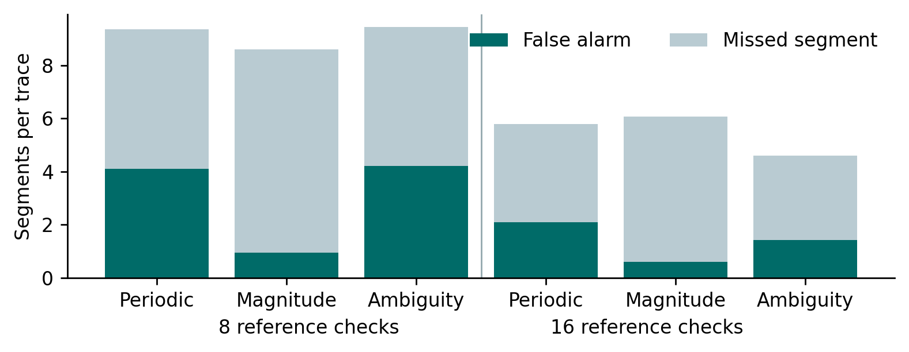

# When should a bead-width monitor spend its next reference measurement?

**Vedant Thaker**  
Working paper · 18 November 2026

## Abstract

A wider bead in a camera image has two plausible explanations. The printer may be extruding too much material, or the camera measurement may have shifted. When both produce the same readings, the monitor needs an independent width check. We compare three ways to schedule eight checks over 160 simulated bead segments. Each policy uses the same estimator, budget and paired traces. Across 12 combinations of fault source and time profile, triggering on estimated width magnitude reduced false alarms from 4.11 to 0.96 per trace relative to regular intervals. Missed out-of-tolerance segments rose from 5.24 to 7.64. Doubling the budget changed which policy made the fewest total errors. A separate pair of traces gives identical camera readings for a process change and a sensor change. The better inspection schedule therefore depends on the available budget and the cost of leaving a real width error undetected.

## The inspection decision

Consider a line-width monitor on a material-extrusion printer. It measures every segment cheaply. A second instrument can check only a few segments per build. Checking after a suspicious reading sounds reasonable. It can also spend the inspection budget on an apparent change while a different, physically consequential change goes unseen.

Liu, Law, Roberson and Kong demonstrated an image-based diagnosis and feedback system on fused filament fabrication [1]. Guidetti and colleagues used extrusion force as a separate signal for controlling deposited width [2]. Both studies motivate the distinction between what the camera sees and what the process produces. An independent signal can be costly, have its own calibration, or measure something other than width. In semiconductor metrology, Han and colleagues studied uncertainty-based sampling under process drift [3]. Their results leave a specific question for image-based bead monitoring. At exactly the same inspection cost, which errors does a change in timing suppress, and which does it leave exposed?

Here the unit of observation is a bead segment. An alarm marks an estimated width deviation beyond tolerance. An alarm never changes the extruder command. This isolates the monitoring decision, so each policy can be scored against exactly the same manufactured trajectory. Changing a control command in response to an alarm would change the physical trajectory and require a different experiment.

## Synthetic bead traces

Each build contains 160 segments. True width is expressed as a deviation from the target in millimetres. A segment is out of tolerance when its absolute true deviation exceeds 0.05 mm. Background variation follows a first-order autoregression with coefficient 0.7 and Gaussian innovations of standard deviation 0.005 mm. The inline camera adds independent Gaussian noise of 0.012 mm. When requested, the reference instrument reads true width with independent Gaussian noise of 0.006 mm. Unrequested reference readings remain unavailable to the monitor.

An imposed shift starts at an integer position sampled uniformly from 24 through 86, counting from zero. Its absolute amplitude is uniform from 0.070 to 0.115 mm, with equiprobable sign. A step persists to the end. A ramp reaches full amplitude over 24 segments. A reversal lasts 14 segments, returns to zero and changes sign at 42 segments after onset with 75% of the original amplitude. These shapes represent contrasting time scales of a disturbance. They have no fitted relationship to a particular printer or material.

The same waveform is routed four ways. It can change true width, change camera bias, move both in opposite directions, or affect neither. The third construction cancels the imposed deviation at the camera. The physical part still sees the full disturbance. Pairing the random draws makes the camera sequence for the process-only case identical to the sequence for the sensor-only case. Likewise, cancellation and stable operation generate identical camera traces. Both identities are tested in the executable. Any policy using only the camera must issue the same decisions for each pair until it obtains independent information.

## Equal-budget comparison

All policies smooth the camera deviation with an exponentially weighted average, giving the newest reading weight 0.45. The bias estimate starts at zero. At a check, the monitor replaces that estimate with the current unsmoothed camera reading minus the reference reading. The alarm for the current segment uses the smoothed camera deviation less the updated bias. A noisy check can therefore affect subsequent segments. Retaining this effect matters because selectively checking unusual observations can distort the bias estimate.

Each block of 20 segments gets exactly one check. The periodic policy takes it at position ten of the block. The magnitude policy takes the first opportunity when the absolute estimated deviation reaches tolerance. The ambiguity policy takes the first opportunity when an allowance around the estimated magnitude overlaps the tolerance. The allowance is 0.010 mm plus 0.002 mm for every segment since the last check. It expresses a possible drift increment and has no probability interpretation. Both triggered policies use the last segment of a block when the condition has not fired. These are causal rules. None sees future readings or fault labels.

For each of the twelve shape-by-source combinations, 320 random runs share their draws across policies. The stable traces recur across shapes by design, giving stable operation the same total weight as each fault source. The paired run index carries across all scenarios. False alarms and missed segments are counted per 160 segments. The same physical segment can contribute at most one error to a given policy. A secondary measure starts at the first genuinely out-of-tolerance segment and counts segments until an alarm coincides with an actual violation. It is capped at 20, including spells with no such detection.

## Which errors move?

Table 1 gives mean counts per 160-segment build, with equal weight across the twelve design cells. Each count is averaged over complete runs. A false alarm occurs on an in-tolerance segment. A miss occurs on an out-of-tolerance segment.

| Inspection setting | Timing rule | False alarms | Misses | Total |
|---|---|---:|---:|---:|
| 8 checks | Periodic | 4.11 | 5.24 | 9.35 |
| 8 checks | Magnitude | 0.96 | 7.64 | 8.60 |
| 8 checks | Ambiguity | 4.22 | 5.23 | 9.45 |
| 16 checks | Periodic | 2.10 | 3.68 | 5.78 |
| 16 checks | Magnitude | 0.61 | 5.47 | 6.07 |
| 16 checks | Ambiguity | 1.42 | 3.17 | 4.59 |

Figure 1. False alarms and missed out-of-tolerance segments per 160-segment trace. Each stacked bar uses the same primary camera-noise setting and gives equal weight to each fault condition. Doubling inspections changes which timing rule minimizes the total.

The eight-check magnitude rule makes 0.75 fewer total errors per build than periodic inspection. The approximate 95% Monte Carlo interval for the paired difference is -1.17 to -0.33. The analogous difference for ambiguity timing is +0.10, with interval -0.32 to +0.52. These intervals use the standard error over 320 independent run indices, each carrying all twelve design cells. They quantify Monte Carlo uncertainty under this generator. Production prevalence, metrology repeatability and the relative cost of a miss are outside that interval.

The location of the errors explains the ranking. Under sensor-only drift, the magnitude rule reduces the average false alarms from 11.86 to 0.59. Under process-only drift, misses increase from 5.55 to 9.88. Under cancellation, misses rise from 15.41 to 20.70. The camera offers no cue to spend a check in the latter case. For a cancellation step specifically, the capped delay is 9.62 segments with periodic inspection and 9.51 with magnitude timing. Similar first-detection delays can coexist with substantially different counts of missed segments over a complete build.

The price of a missed segment determines whether the aggregate gain is useful. At eight checks, magnitude timing saves about 3.15 false alarms at the cost of 2.41 additional misses relative to periodic timing. If one miss costs more than approximately 1.31 false alarms, the periodic policy has lower expected cost under this scenario mixture. The calculation assumes additive costs per segment. A shop that scraps a whole part after the first defect would need a part-level outcome.

## Sensitivity and transfer

At sixteen checks the ambiguity rule has the fewest errors in the equal-weight design. Doubling camera noise to 0.024 mm while retaining eight checks changes the picture again. Periodic inspection produces 18.23 errors per build, ambiguity timing 19.96 and magnitude timing 20.01. The last two differ by only 0.05 on this scale. Their totals conceal different types of errors. Magnitude timing produces 13.83 misses, while ambiguity timing produces 6.74.

The experiment assigns the same cost and immediate turnaround to every reference measurement. A real instrument may interrupt deposition, observe the bead only after cooling, or average over several segments. Bias can also vary with illumination, local curvature or nozzle speed. The monitor here uses a single noisy difference to reset a bias estimate. Averaging repeated checks, modelling correlated metrology errors, and allowing an unspent check to carry over could each change the policy ordering. The cancellation example would still apply whenever the inline signal measures only the sum of the physical change and sensor bias.

## Conclusion and reproducibility

The eight-check experiment gives a concrete choice. Magnitude-triggered inspection is attractive when false alarms dominate the cost and additive drift is visible. A periodic check retains value when a fault can hide under a compensating sensor change. Both claims depend on the inspector seeing an independently measured width. A direct validation would hold the extrusion path fixed, vary feed and optical calibration separately, and obtain blinded reference measurements at every candidate segment offline. The three schedules could then replay the same traces without granting any policy extra measurements.

Running `python run.py` regenerates results.csv using NumPy and seed 90217. Each row records the shape, source, camera noise, block size, policy, paired run index, error counts, true out-of-tolerance count and capped delay. A delay of -1 marks a run with no out-of-tolerance segment. The study used Python 3.11.9 and NumPy 1.26.0.

## Research and writing assistance

Vedant Thaker supplied the research brief and source materials. OpenAI Codex assisted with study design, implementation, execution, literature review and drafting. Clever Humanizer suggested edits to the abstract. The final wording was checked against the analysis.

## References

[1] C. Liu, A. C. C. Law, D. Roberson and Z. Kong. Image analysis-based closed loop quality control for additive manufacturing with fused filament fabrication. Journal of Manufacturing Systems 51, 75-86 (2019). https://doi.org/10.1016/j.jmsy.2019.04.002

[2] X. Guidetti and colleagues. Force Controlled Printing for Material Extrusion Additive Manufacturing. Preprint (2024). https://arxiv.org/abs/2403.16042

[3] X. Han, M. Miller, J. Moyne, G. W. Vogl, A. Penkova and X. Jia. A Comparative Study of Semiconductor Virtual Metrology Methods and Novel Algorithmic Framework for Dynamic Sampling. IEEE Transactions on Semiconductor Manufacturing 38 (2025). https://tsapps.nist.gov/publication/get_pdf.cfm?pub_id=958452
